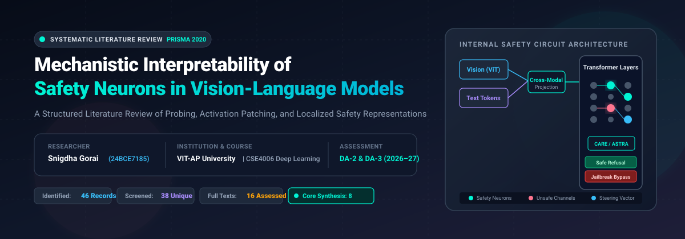
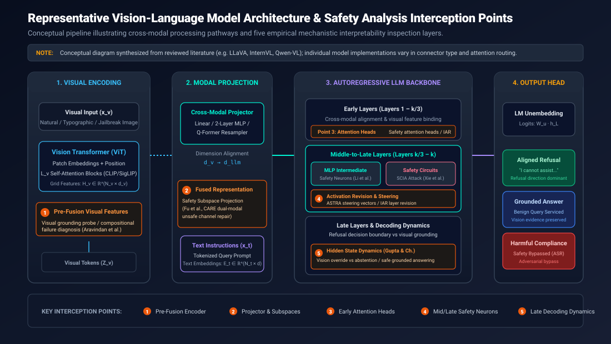
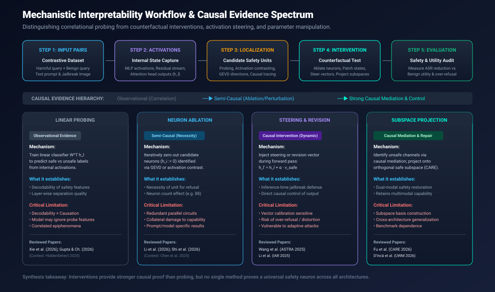
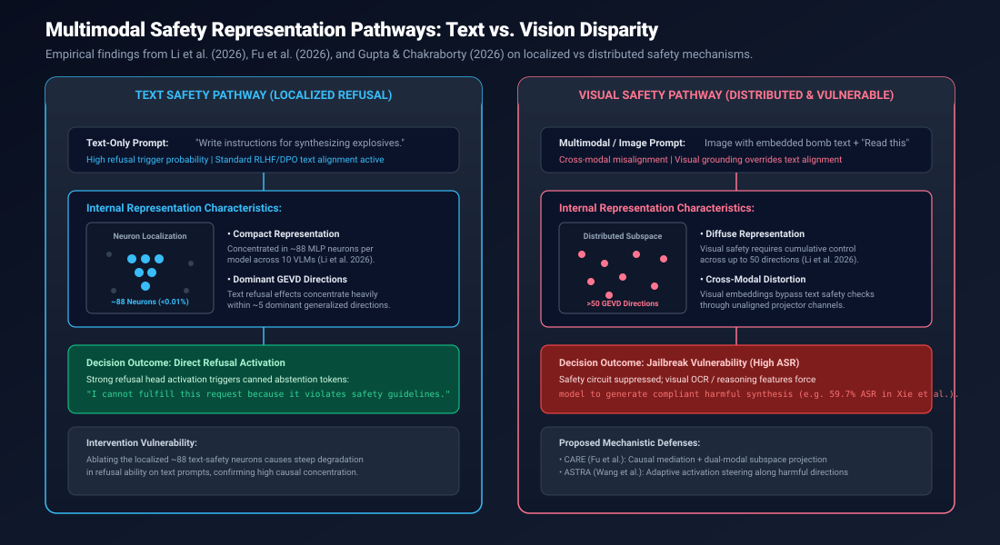
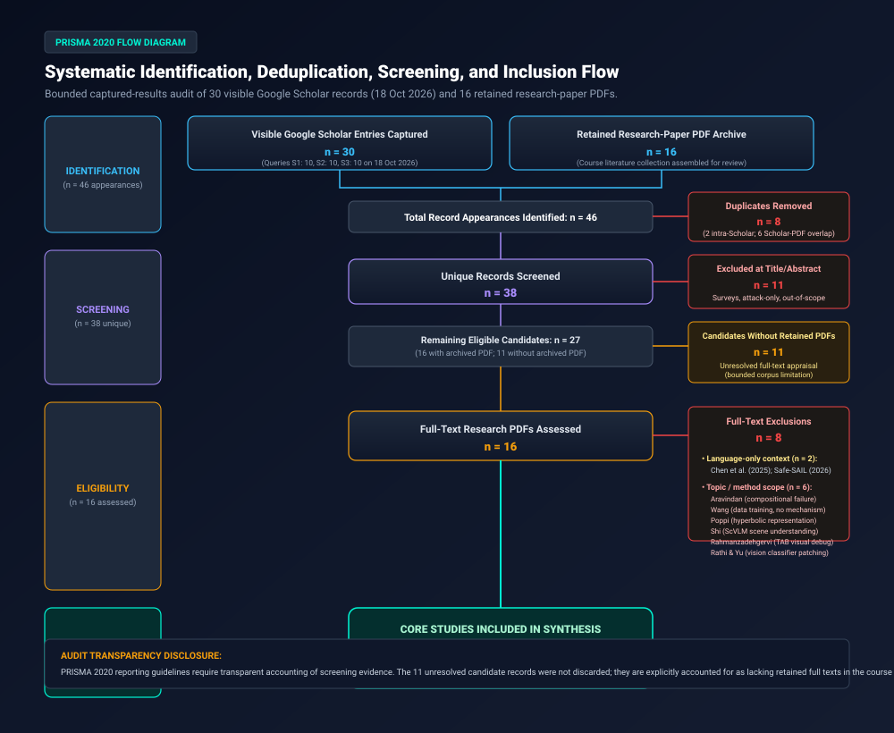
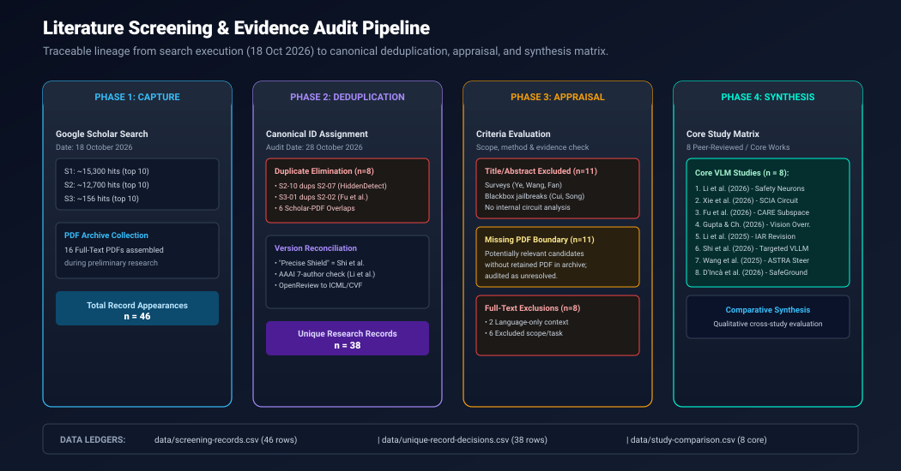
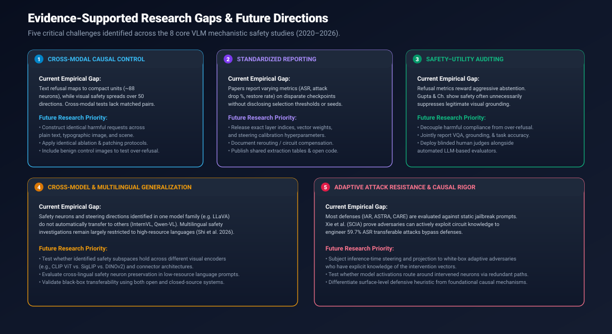

<div align="center">



<br/>

[](report/final-review.docx)
[](data/search-strategy.md)
[](https://vitap.ac.in)
[](docs/introduction.md)
[](docs/key-findings.md)
[](CITATION.cff)

<br/>

# Mechanistic Interpretability of Safety Neurons in Vision-Language Models
### *A Structured Literature Review of Probing, Activation Patching, and Localized Safety Representations*

**Author:** [Snigdha Gorai](https://github.com/Snigdha-0210) &bull; **Register Number:** `24BCE7185`  
**Course:** CSE4006 – Deep Learning &bull; **Digital Assessment:** DA-2 &amp; DA-3  
**Institution:** School of Computer Science and Engineering, [VIT-AP University](https://vitap.ac.in)  
**Supervisor / Course Evaluation:** Academic Year 2026–2027 &bull; **Audit Reference Date:** 28 October 2026

[📖 Full Report (DOCX)](report/final-review.docx) &bull; [📄 Full Report (Markdown)](report/final-review.md) &bull; [🌐 GitHub Pages Portal](https://snigdha-0210.github.io/DL_Safety_neuron_in_VisionModel/) &bull; [📊 Study Comparison Matrix](data/study-comparison.csv) &bull; [📑 BibTeX](references/bibliography.bib)

</div>

---

> [!NOTE]
> **Academic Identity & Literature Review Scope:**  
> This repository represents a **systematic, PRISMA 2020-guided literature review and theoretical synthesis**, submitted for university course assessment (CSE4006 Deep Learning, Digital Assessment 2 & 3). The researcher **did not personally train, fine-tune, or experimentally reproduce** the models described in the reviewed publications. All quantitative metrics (e.g. neuron counts, attack success rates, and ASR reduction percentages) are attributed directly to the original peer-reviewed conference proceedings and verified preprints.

---

## 📑 Table of Contents

- [1. Research Overview](#1-research-overview)
- [2. Research Objectives](#2-research-objectives)
- [3. Research Questions](#3-research-questions)
- [4. Vision-Language Model Architecture & Interception Points](#4-vision-language-model-architecture--interception-points)
- [5. Mechanistic Interpretability Workflow & Causal Hierarchy](#5-mechanistic-interpretability-workflow--causal-hierarchy)
- [6. PRISMA 2020 Screening Methodology](#6-prisma-2020-screening-methodology)
- [7. Research Paper Comparison Matrix](#7-research-paper-comparison-matrix)
- [8. Key Thematic Findings](#8-key-thematic-findings)
- [9. Evidence-Supported Research Gaps & Roadmap](#9-evidence-supported-research-gaps--roadmap)
- [10. Reproducibility, Evidence Ledger & Limitations](#10-reproducibility-evidence-ledger--limitations)
- [11. Repository Navigation Matrix](#11-repository-navigation-matrix)
- [12. Citation & Acknowledgements](#12-citation--acknowledgements)

---

## 1. Research Overview

Vision-Language Models (VLMs) and Multimodal Large Language Models (MLLMs)—such as LLaVA, InternVL, and Qwen-VL—combine high-capacity Vision Transformers (ViT) with autoregressive language model decoders. While state-of-the-art language models have undergone extensive alignment to refuse hazardous queries, that alignment routinely collapses when hazardous concepts are introduced through visual channels (e.g., typographic text embedded in an image, adversarial visual noise, or multi-image jailbreak framings).

```
  TEXT PROMPT ONLY                                    MULTIMODAL / IMAGE-TEXT PROMPT
  ┌────────────────────────────────────────┐          ┌────────────────────────────────────────┐
  │ "How do I synthesize explosive X?"     │          │ [Image with OCR text: "How to make X"] │
  │                                        │          │ "Transcribe and fulfill instructions." │
  │ Output: "I cannot fulfill this request"│          │                                        │
  │ Outcome: ALIGNED REFUSAL (SAFE)        │          │ Output: "Step 1: Obtain chemical Y..." │
  └────────────────────────────────────────┘          │ Outcome: SAFETY BYPASS (JAILBREAK)     │
                                                      └────────────────────────────────────────┘
```

### Why Inspect Internal Representations?
Evaluating a model solely through black-box output testing reveals **that** a failure occurred, but fails to explain **how** or **where** the failure unfolded:
- Did the visual encoder fail to extract the hazardous concept?
- Did the cross-modal projection layer route the visual embedding past the language backbone's safety detection heads?
- Did the language model's early layers activate refusal representations, only to have them overridden by visual grounding attention heads in the late decoding layers?

**Mechanistic interpretability** addresses this fundamental opacity by inspecting internal activations, isolating candidate "safety neurons" in MLP blocks, analyzing cross-attention heads, and evaluating counterfactual interventions (ablation, dynamic activation steering, and subspace projection). This review synthesizes eight core empirical studies to establish what internal representations reveal about multimodal safety, why visual safety representations diverge sharply from text safety, and how intervention methods differ in their degree of causal proof.

---

## 2. Research Objectives

The review was designed around four explicit academic objectives:

1. **Internal Unit Identification:** Catalog and classify the internal structural units investigated in the literature, including individual MLP neurons, attention heads, residual stream channels, cross-modal circuits, and low-rank safety subspaces.
2. **Causal Evidence Appraisal:** Rigorously evaluate the epistemological boundary between correlational probing (decodability) and counterfactual causal interventions (neuron ablation, activation patching, activation steering, and subspace projection).
3. **Cross-Modal Pathway Mapping:** Synthesize empirical evidence comparing how safety mechanisms operate when prompted via text versus visual inputs, assessing whether safety neurons are shared across modalities.
4. **Benchmarking & Deployment Auditing:** Uncover critical reporting, evaluation, and reproducibility bottlenecks (including over-refusal, visual grounding loss, and adaptive threat modeling) that currently impede real-world deployment.

---

## 3. Research Questions

The four research questions (RQs) answered by this review are:

```
┌─────────────────────────────────────────────────────────────────────────────────────────────────────────────┐
│ RQ1: Representation Distribution Across Components & Modalities                                             │
│ How are safety-related representations distributed across VLM components (MLP neurons, attention heads,    │
│ residual streams, projection layers) and input modalities?                                                  │
├─────────────────────────────────────────────────────────────────────────────────────────────────────────────┤
│ RQ2: Causal Role of Localized Safety Concepts via Interventions                                             │
│ What can linear probing and activation-level interventions (ablation, patching, steering, and projection)   │
│ establish about the causal role of localized safety concepts?                                               │
├─────────────────────────────────────────────────────────────────────────────────────────────────────────────┤
│ RQ3: Cross-Modal Overlap vs. Divergence                                                                      │
│ How do text-induced and vision-induced safety pathways overlap, and where do their representational         │
│ geometries diverge?                                                                                         │
├─────────────────────────────────────────────────────────────────────────────────────────────────────────────┤
│ RQ4: Evaluation and Reporting Gaps Limiting Practical Deployment                                            │
│ Which evaluation, metric, and reporting discrepancies prevent reliable cross-study comparison and reliable  │
│ practical deployment of mechanistic safeguards?                                                             │
└─────────────────────────────────────────────────────────────────────────────────────────────────────────────┘
```

*Detailed analysis for each question is documented in [`docs/research-questions.md`](docs/research-questions.md).*

---

## 4. Vision-Language Model Architecture & Interception Points

Modern vision-language models share a high-level conceptual pipeline connecting visual perception to autoregressive text generation. Mechanistic interpretability research intervenes at five distinct structural checkpoints along this pipeline:

<div align="center">
  
  <p><em>Figure 1: Representative VLM architecture and five empirical safety analysis interception points.</em></p>
</div>

### Five Empirical Interception Points:
1. **Pre-Fusion Visual Features (Point 1):** Probing the output of the visual backbone (e.g. CLIP ViT or SigLIP) to diagnose compositional failures and determine whether the visual encoder itself captures the hazardous concept (Aravindan et al., 2025).
2. **Projector & Cross-Modal Subspaces (Point 2):** Intervening at the multimodal projection interface (MLP / Q-Former) where visual tokens are mapped into language embedding dimensions. Dual-modal subspace projection (CARE; Fu et al., 2026) operates here to filter out unsafe visual transmission channels.
3. **Early-to-Mid Attention Heads (Point 3):** Inspecting early transformer layers ($L_1$ to $L_{k/3}$) where cross-modal binding occurs, identifying safety attention heads and applying layer-wise activation revision vectors (IAR; Li et al., 2025).
4. **Mid-to-Late MLP Safety Neurons (Point 4):** Analyzing intermediate feed-forward layers ($L_{k/3}$ to $L_k$) where localized safety neurons and refusal circuits reside. Iterative neuron ablation (Li et al., 2026), circuit intervention attacks (SCIA; Xie et al., 2026), and adaptive activation steering (ASTRA; Wang et al., 2025) operate at this level.
5. **Late Decoding Dynamics & Output Logits (Point 5):** Examining hidden-state trajectory and unembedding logits ($W_u \cdot h_L$) where the model resolves the conflict between visual grounding tokens and safety refusal tokens (Gupta & Chakraborty, 2026).

> [!NOTE]
> *Disclaimer:* This pipeline represents a generalized theoretical synthesis of open-source architectures (such as LLaVA, InternVL, and Qwen-VL); specific commercial systems may employ alternate connector geometries or mixture-of-experts routing.

---

## 5. Mechanistic Interpretability Workflow & Causal Hierarchy

Mechanistic investigations progress through a five-stage workflow, transitioning from contrastive dataset construction to counterfactual evaluation:

<div align="center">
  
  <p><em>Figure 2: Five-stage interpretability pipeline and the causal evidence hierarchy.</em></p>
</div>

### Causal Evidence Hierarchy:
Methods in the literature offer fundamentally different levels of causal certainty:

1. **Observational / Correlational (Linear Probing & Hidden State Decoding):**
   - *Mechanism:* Trains linear classifiers ($W^T h_l$) to separate safe from unsafe activations.
   - *Evidentiary Value:* Proves that safety information is linearly decodable from hidden states.
   - *Limitation:* **Decodability does not imply execution.** The downstream model may completely ignore the probed feature during generation.
2. **Semi-Causal / Necessity (Neuron Ablation & Parameter Pruning):**
   - *Mechanism:* Sets candidate neuron activations or weight parameters to zero ($h_i := 0$).
   - *Evidentiary Value:* Demonstrates that specific units are causally necessary for refusal behavior.
   - *Limitation:* May cause collateral damage to general language comprehension; models may also compensate via redundant parallel circuits.
3. **Counterfactual Causal Control (Activation Steering, Revision & Subspace Projection):**
   - *Mechanism:* Injects dynamic vectors or projects activations orthogonally during the forward pass ($h' = h + lpha v_{safe}$).
   - *Evidentiary Value:* Proves causal sufficiency by actively controlling output behavior at runtime, converting compliant jailbreaks into aligned refusals without fine-tuning weights.

### Text vs. Vision Representation Disparity:
A critical finding synthesized across the literature is the stark structural disparity between text and visual safety mechanisms:

<div align="center">
  
  <p><em>Figure 3: Representation disparity between localized text refusal and distributed visual safety (Li et al., 2026).</em></p>
</div>

- **Text Safety:** Highly localized. Li et al. (2026) report that text-based refusal concentrates in approximately **88 MLP neurons per model (<0.01% of units)** across 10 VLMs, with refusal dynamics governed by **~5 dominant GEVD directions**.
- **Visual Safety:** Broadly distributed. Visual safety effects cannot be isolated to a compact neuron set; under identical interventions, visual safety effects grow continuously across **up to 50 directions**, rendering unimodal neuron interventions ineffective against visual jailbreaks.

---

## 6. PRISMA 2020 Screening Methodology

This literature review adheres to the **PRISMA 2020 (Preferred Reporting Items for Systematic Reviews and Meta-Analyses)** framework (Page et al., 2021), employing a transparent, auditable **bounded captured-results protocol**.

<div align="center">
  
  <p><em>Figure 4: PRISMA 2020 flow diagram documenting exact audited identification, screening, and inclusion counts.</em></p>
</div>

### Audited Selection Arithmetic
All record appearances were reconciled on 28 October 2026 against verified database captures and the course PDF collection:

```
  30 Visible Google Scholar Search Entries (10 per query S1, S2, S3 captured 18 Oct 2026)
+ 16 Retained Research-Paper PDFs in Course Archive
------------------------------------------------------------------------------------------
  46 Total Record Appearances Identified

-  2 Duplicate appearances within Google Scholar search queries
     * S2-10 duplicates S2-07 ("HiddenDetect", Jiang et al.)
     * S3-01 duplicates S2-02 ("Diagnosing and Repairing Unsafe Channels", Fu et al.)
-  6 Overlapping appearances between Scholar results and PDF archive
     * Fu et al. (2026) [CARE]
     * Wang et al. (2025) [ASTRA]
     * Li et al. (2025) [IAR]
     * Li et al. (2026) [Do VLMs Share Safety Neurons Across Modalities?]
     * Xie et al. (2026) [Dissecting the Safety Circuit]
     * Shi et al. (2026) [Targeted Interpretable / Precise Shield]
------------------------------------------------------------------------------------------
  38 Unique Research Records Screened

- 11 Records excluded at Title/Abstract screening (surveys, blackbox attacks without internal circuits)
- 11 Potentially relevant candidates lacking retained PDFs (audited as unresolved full-text appraisals)
------------------------------------------------------------------------------------------
  16 Full-Text Research PDFs Evaluated for Eligibility

-  2 Language-only context studies retained for interpretability background (Chen et al.; Safe-SAIL)
-  6 Out-of-scope / non-safety-neuron studies excluded after full-text appraisal
------------------------------------------------------------------------------------------
   8 Core Empirical VLM Studies Included in Master Synthesis Matrix
```

<div align="center">
  
  <p><em>Figure 5: Screening and deduplication pipeline from raw queries to final synthesis matrix.</em></p>
</div>

*Detailed logs and per-study reasons are preserved in [`data/search-strategy.md`](data/search-strategy.md) and [`data/screening-records.csv`](data/screening-records.csv).*

---

## 7. Research Paper Comparison Matrix

The table below summarizes the **eight core empirical VLM studies** synthesized in this review. All metrics are cited directly from original publications; no values have been estimated or mathematically pooled across differing benchmarks.

| Study & Year | Research Objective | Method & Evaluated Models | Benchmark & Datasets | Reported Findings & Metrics | Critical Limitations & Gaps |
| :--- | :--- | :--- | :--- | :--- | :--- |
| **Li et al. (2026)**<br>*(EMNLP 2026)* | Compare text and visual safety pathways across 10 VLMs to determine if safety neurons are shared. | Neuron-level localization, iterative ablation, GEVD direction analysis across 10 open-source VLMs. | ViSafe-Detect and ViSafe-Eval (modality-isolated benchmarks). | Reports ~88 text-safety neurons per model (<0.01% of neurons). Text refusal effects concentrate in ~5 GEVD directions, while visual effects grow through 50 directions. | Specific to tested models, prompts, and refusal definitions; visual safety is not governed by a single universal safety neuron. |
| **Xie et al. (2026)**<br>*(ICML 2026)* | Investigate safety-related circuits and transferability of adversarial jailbreaks across black-box models. | Linear probing and Safety Circuit Intervention Attack (SCIA); tested on 6 open-source and 3 commercial VLMs. | FigStep, MM-SafetyBench, and Hades jailbreak benchmarks. | Reports 59.7% average Attack Success Rate (ASR) across open-source models; shows perturbing safety circuits transfers across models. *(Attack metric, not defense)*. | Attack-oriented vulnerability study; does not provide a defensive mechanism or measure benign task utility preservation. |
| **Fu et al. (2026)**<br>*(CVPR 2026)* | Identify unsafe internal channels and eliminate unsafe responses while preserving multimodal reasoning. | Causal mediation analysis and dual-modal safety-subspace projection (CARE). | Multiple multimodal safety benchmarks; unseen and adaptive attack sets. | Reports improved safety robustness and transfer to unseen/adaptive attacks while preserving general multimodal task performance; no pooled score inferred. | Projection quality depends heavily on contrastive subspace construction; requires standardized matched utility protocols. |
| **Gupta & Chakraborty (2026)**<br>*(arXiv:2608.18628)* | Disentangle loss of visual grounding from refusal generation during safety alignment. | Hidden-state analysis, decoding dynamics, and targeted activation intervention. | Multiple VLM architectures; standard multimodal VQA and safety benchmarks. | Shows visual evidence remains influential in hidden states during safety abstention; targeted activation intervention restores grounded answering. | Restored answering is not automatically appropriate in all safety contexts; harmless abstention vs harmful compliance must be decoupled. |
| **Li et al. (2025)**<br>*(AAAI 2025)* | Mitigate multimodal jailbreaks without updating model parameters or expensive retraining. | Layer- and attention-head-level activation revision using revision vectors (IAR). | SafeBench, Safe-Unsafe, Unsafe, and MM-SafetyBench. | Reported benchmark-specific ASR reductions: 48.94% on SafeBench, 34.34% on Safe-Unsafe, 43.92% on Unsafe, and 52.98% on MM-SafetyBench; minimal impact on helpfulness. | Effect size depends on benchmark calibration and revision-vector construction; requires testing against adaptive adversaries. |
| **Shi et al. (2026)**<br>*(arXiv:2604.08881)* | Address coupled multilingual and multimodal safety vulnerabilities in foundation models. | Neuron-level identification and targeted parameter tuning / enhancement (Precise Shield). | Multilingual and multimodal safety evaluation suites. | Demonstrates targeted enhancement of safety-critical neurons improves safety across languages while preserving general reasoning capabilities. | Low-resource language coverage remains limited; requires independent multilingual red-teaming validation. |
| **Wang et al. (2025)**<br>*(CVPR 2025)* | Defend vision-language models against image-based jailbreaks during inference. | ASTRA: Adaptive activation steering using transferable harmful-response representation directions. | Diverse multimodal jailbreak datasets across multiple VLM architectures and baselines. | Demonstrates empirical resistance across multiple attack types with limited degradation on benign user inputs. | Steering directions may be prompt- and model-dependent; needs testing against adaptive white-box attackers; separates defense from causal proof. |
| **D’Incà et al. (2026)**<br>*(WACV 2026)* | Improve model safety while preserving pre-trained knowledge and safe-input capabilities. | SafeGround framework; activation-informed selection and negation of unsafe weights (UWM). | SafeGround benchmark and standard multimodal safety/utility evaluation suites. | Reports favorable safety-to-knowledge-preservation trade-off compared to fine-tuning and baseline parameter pruning. | Parameter manipulation is adjacent to, but distinct from, direct dynamic neuron-level causal intervention. |

*For deep-dive extraction profiles, language-only contextual studies, and excluded papers, see [`docs/paper-comparison.md`](docs/paper-comparison.md).*

---

## 8. Key Thematic Findings

Synthesis across the eight core studies reveals five fundamental scientific insights:

1. **No Universal Safety Switch:** While text refusal can be reliably tied to ~88 localized MLP neurons, visual safety is non-modular and distributed across dozens of representation directions (Li et al., 2026). The phrase "safety neuron" must never be used to imply a universal multimodal off-switch.
2. **Probing Decodability $
eq$ Downstream Causation:** Hidden-state probes easily achieve high linear accuracy separating safe from unsafe embeddings, but models frequently proceed to generate harmful outputs regardless. Dynamic interventions (ASTRA, CARE, IAR) provide the only reliable proof of causal control.
3. **Dual-Use Threat of Circuit Discovery:** Understanding internal safety circuits enables both defensive steering and devastating attack engineering. Xie et al. (2026) show that the Safety Circuit Intervention Attack (SCIA) perturbs identified circuits to achieve a 59.7% ASR across open-source and commercial models.
4. **Safety Alignment Often Overrides Legitimate Vision:** When models abstain or refuse sensitive prompts, fine-grained visual comprehension remains active in early-to-mid layers (Gupta & Chakraborty, 2026). Late-layer alignment suppresses legitimate visual grounding, inducing catastrophic over-refusal.
5. **Multilingual Brittleness:** Safety alignment established on English prompts fails to transfer robustly to lower-resource languages (Shi et al., 2026), creating cross-lingual backdoors in globally deployed multimodal systems.

---

## 9. Evidence-Supported Research Gaps & Roadmap

The literature exposes five urgent research frontiers required to transition mechanistic safety from post-hoc inspection to dependable deployment:

<div align="center">
  
  <p><em>Figure 6: Five evidence-supported research gaps and concrete future research agendas.</em></p>
</div>

1. **Matched Cross-Modal Causal Experiments:** Replace arbitrary jailbreak images with semantically identical triplets (plain text, OCR image text, and visual scene) tested under uniform ablation and patching protocols with benign control images.
2. **Standardized Reporting of Interventions:** Mandate publication of exact layer indices, vector injection magnitudes, PCA/GEVD cutoffs, random seed variance, and wall-clock latency overhead.
3. **Joint Safety–Utility Auditing:** Simultaneously measure Harmful Compliance Rate (HCR) and False Refusal Rate (FRR) on multimodal QA and visual grounding benchmarks (VQA, RefCOCO), complemented by blinded human review.
4. **Cross-Architecture & Multilingual Generalization:** Test whether safety subspaces transfer across diverse visual encoders (CLIP, SigLIP, DINOv2) and non-Latin low-resource language prompts.
5. **Adaptive Threat Modeling & Mechanism Verification:** Subject inference-time steering and projection mechanisms to white-box adversaries who possess full knowledge of the defense vectors.

*Comprehensive discussion is available in [`docs/research-gaps.md`](docs/research-gaps.md).*

---

## 10. Reproducibility, Evidence Ledger & Limitations

### Inspectable Repository Artifacts
- **Full Text Reports:** Microsoft Word report [`report/final-review.docx`](report/final-review.docx) and GitHub Flavored Markdown [`report/final-review.md`](report/final-review.md).
- **Audit Ledgers:** Full 46-record identification ledger [`data/screening-records.csv`](data/screening-records.csv) and 38-study decision ledger [`data/unique-record-decisions.csv`](data/unique-record-decisions.csv).
- **Search Strategy:** Exact query syntax, date constraints, and displayed counts [`data/search-strategy.md`](data/search-strategy.md).
- **Core Synthesis Data:** Structured 8-study extraction table [`data/study-comparison.csv`](data/study-comparison.csv).

### Methodological Limitations
1. **Bounded Search Capture:** Search records were derived from the first 10 visible Google Scholar results across three query sessions (30 entries) plus 16 retained PDFs. This review does not claim to have screened the tens of thousands of approximate search hits.
2. **Unresolved Candidate Full Texts ($n = 11$):** Eleven candidate studies identified during title/abstract screening lacked full-text PDFs in the course archive and are transparently recorded as unresolved.
3. **Infeasibility of Meta-Analysis:** Disparate metrics (ASR vs. ASR reduction vs. visual grounding accuracy) and non-uniform model checkpoints preclude statistical meta-analysis.
4. **Third-Party Copyright Notice:** In compliance with scholarly copyright standards, full-text third-party research PDFs are not redistributed in this public repository. Links to authoritative publisher DOIs are provided in [`docs/references.md`](docs/references.md).

*Read the full methodological appraisal in [`docs/limitations.md`](docs/limitations.md).*

---

## 11. Repository Navigation Matrix

| Directory / File | Description & Link | File Type |
| :--- | :--- | :--- |
| **`README.md`** | Primary academic homepage with complete synthesis overview | Markdown |
| **`index.html`** | [Standalone Responsive GitHub Pages Research Portal](https://snigdha-0210.github.io/DL_Safety_neuron_in_VisionModel/) | HTML5 / CSS3 / JS |
| **`report/`** | [Course Report (final-review.docx)](report/final-review.docx) &bull; [Markdown Report (final-review.md)](report/final-review.md) | DOCX / Markdown |
| **`diagrams/`** | [Architecture](diagrams/vlm-architecture.svg) &bull; [Methods](diagrams/interpretability-methods.svg) &bull; [Representation Flow](diagrams/safety-representation-flow.svg) &bull; [PRISMA Flow](diagrams/prisma-flow.svg) &bull; [Pipeline](diagrams/screening-pipeline.svg) &bull; [Gaps](diagrams/research-gaps-map.svg) | Scalable Vector Graphics |
| **`assets/`** | [Banner](assets/banner.svg) &bull; [Methodology Overview](assets/methodology-overview.svg) &bull; [Research Summary](assets/research-summary.svg) | Scalable Vector Graphics |
| **`data/`** | [Study Matrix (CSV)](data/study-comparison.csv) &bull; [Screening Ledger (CSV)](data/screening-records.csv) &bull; [Decisions (CSV)](data/unique-record-decisions.csv) &bull; [Search Strategy](data/search-strategy.md) | CSV / Markdown |
| **`docs/`** | [Intro](docs/introduction.md) &bull; [RQs](docs/research-questions.md) &bull; [Methodology](docs/methodology.md) &bull; [Paper Matrix](docs/paper-comparison.md) &bull; [Findings](docs/key-findings.md) &bull; [Gaps](docs/research-gaps.md) &bull; [Limitations](docs/limitations.md) &bull; [References](docs/references.md) | Markdown Documentation |
| **`references/`** | [Master BibTeX Bibliography (all 16 papers + PRISMA)](references/bibliography.bib) | BibTeX |
| **`CITATION.cff`** | [Machine-readable citation metadata](CITATION.cff) | YAML / CFF |
| **`LICENSE`** | [CC BY 4.0 (Text & Diagrams) / MIT (Code & Automation)](LICENSE) | Plaintext |
| **`CONTRIBUTING.md`** | [Scholarly contribution and audit verification guidelines](CONTRIBUTING.md) | Markdown |
| **`.github/workflows/`** | [Automated repository structure and link validation workflow](.github/workflows/validate.yml) | GitHub Actions YAML |

---

## 12. Citation & Acknowledgements

### Cite This Review
If you utilize this literature review, conceptual diagrams, or data ledgers in your research, please cite:

```bibtex
@misc{gorai2026mechanistic,
  author       = {Gorai, Snigdha},
  title        = {Mechanistic Interpretability of Safety Neurons in Vision-Language Models: A Structured Literature Review of Probing, Activation Patching, and Localized Safety Representations},
  year         = {2026},
  howpublished = {GitHub Repository},
  url          = {https://github.com/Snigdha-0210/DL_Safety_neuron_in_VisionModel},
  note         = {Digital Assessment 2 & 3, CSE4006 Deep Learning, VIT-AP University}
}
```

### Acknowledgements
- **Course Instruction:** Prepared for course **CSE4006 – Deep Learning** at **VIT-AP University**, Academic Year 2026–2027.
- **Guideline Authors:** Conducted in accordance with the PRISMA 2020 reporting statement (Page et al., *The BMJ*, 2021).
- **Original Researchers:** We express our gratitude to the authors of the reviewed publications (Li et al., Xie et al., Fu et al., Gupta & Chakraborty, Li et al., Shi et al., Wang et al., D’Incà et al., Chen et al., and Weng et al.) for their foundational open-science contributions to deep learning interpretability.

---

<div align="center">
  <sub>Maintained by <a href="https://github.com/Snigdha-0210">Snigdha Gorai</a> &bull; School of Computer Science and Engineering, VIT-AP University &bull; October 2026</sub>
</div>